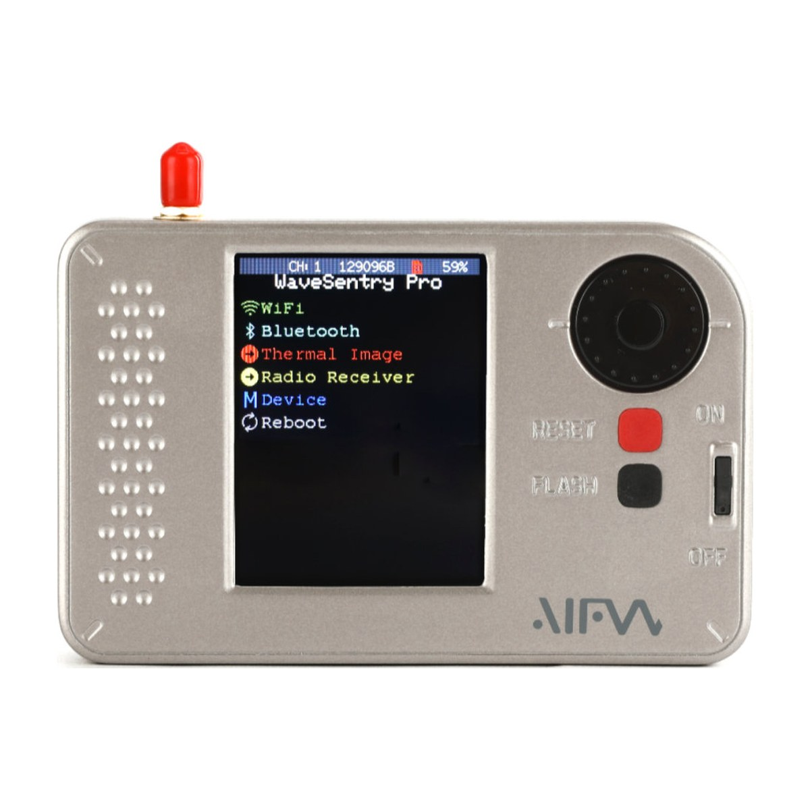
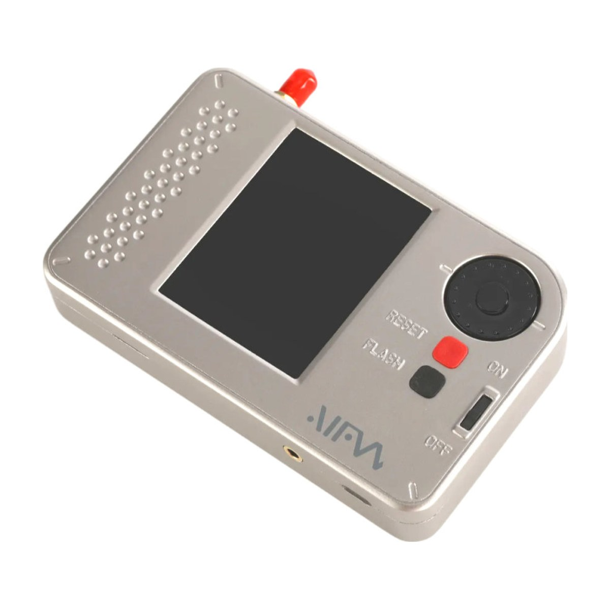

# WaveSentry

Firmware source code, schematic and firmware files for the **OpenSourceSDRLab WaveSentry** and **WaveSentry Pro**, portable ESP32 multi-tools with an AM/FM radio receiver, Wi-Fi and Bluetooth analysis and, on the Pro, a thermal imaging camera.

  
  

## Product link

<https://opensourcesdrlab.com/products/aifw-wavesentry-esp32>

## About the device

- Microcontroller: Espressif **ESP32-WROOM-32E** (Wi-Fi and Bluetooth LE)
- Radio receiver: Silicon Labs **SI4732** AM/FM receiver with SMA antenna input, speaker amplifier and 3.5 mm headphone jack
- Display: 2.8-inch ILI9341 TFT with resistive touch (XPT2046), rotary encoder and buttons
- Thermal camera (WaveSentry Pro only): Melexis **MLX90640** 32 × 24 thermal sensor
- microSD card slot, USB-C (CP2102 USB-UART) for flashing and the serial console
- Li-ion battery with BQ24075 charger and MAX17055 fuel gauge
- The firmware is derived from the ESP32 Marauder project. It keeps the passive Wi-Fi and Bluetooth analysis functions (sniffers, AP and station scans, signal monitor) and adds the radio receiver and the thermal camera.

| Function | WaveSentry | WaveSentry Pro |
|---|---|---|
| Wi-Fi sniffers: probe requests, beacons, packet monitor, raw capture, station sniff, signal monitor, AP scan | yes | yes |
| Bluetooth sniffers: Bluetooth, Flipper, AirTag | yes | yes |
| AM/FM radio receiver | yes | yes |
| Thermal imaging | no | yes |

## Quick start

1. Download the firmware files from the [Releases](../../releases) page.
2. Connect the WaveSentry with a USB-C cable and write the files at the offsets given in the release notes with an ESP32 flashing tool (chip **ESP32**, 80 MHz, DIO, 921600 baud).
3. Press RESET. The WaveSentry starts with the main menu.

The full steps, including building the open-source firmware from source, are in the **[Quick Start Guide](docs/Quick-Start-Guide.md)** ([PDF](docs/Quick-Start-Guide.pdf)).

## Repository layout

| Path | Contents |
|---|---|
| `WaveSentry_Community/` | Source code of the WaveSentry firmware (Arduino sketch, original user interface) |
| `WaveSentry-V2.0/` | Source code of the WaveSentry firmware with the LVGL user interface (PlatformIO project) |
| `hardware/` | Schematic (PDF) |
| `docs/` | Quick Start Guide (Markdown and PDF) |
| `images/` | Product photos |

The firmware for the WaveSentry Pro (thermal camera) is provided as a binary on the Releases page; its source code is not published at present.

## Downloads (Releases)

Firmware files are attached to the [Releases](../../releases) page instead of being stored in the repository:

| File | Contents |
|---|---|
| `WaveSentry-Pro_V2.4_firmware.zip` | WaveSentry Pro firmware with the LVGL user interface: `bootloader.bin`, `partitions.bin`, `firmware.bin` and flashing offsets |
| `SHA256SUMS.txt` | SHA-256 checksums of the files above |

The WaveSentry is also supported by the open-source Bruce firmware: download the `WaveSentry-R1` build from the official Bruce releases (project BruceDevices/firmware on GitHub).

Check a download with `shasum -a 256 -c SHA256SUMS.txt` (macOS / Linux) or `certutil -hashfile <file> SHA256` (Windows).

## Videos

- WaveSentry overview: <https://www.youtube.com/watch?v=veseDgtHWbk>
- WaveSentry radio receiver: <https://www.youtube.com/watch?v=38EMz9IIhAg>
- WaveSentry Pro with thermal imaging and AM/FM radio: <https://www.youtube.com/watch?v=nHMRX_xDvgA>

## Licence

Files created by OpenSourceSDRLab are released under the [Apache License 2.0](LICENSE). The firmware source code is derived from ESP32 Marauder and includes third-party libraries that remain under their own licences (MIT, GPL-3.0 and others); see [NOTICE.md](NOTICE.md).

## Support

- Email: support@opensourcesdrlab.com
- Forum: <https://forum.opensourcesdrlab.com>
- Discord: <https://discord.gg/nnxY6DkmvT>
- Blog and user manuals: <https://blog.opensourcesdrlab.com>

---
© 2026 OpenSourceSDRLab. All rights reserved. · <a href="https://www.opensourcesdrlab.com">www.opensourcesdrlab.com</a>
